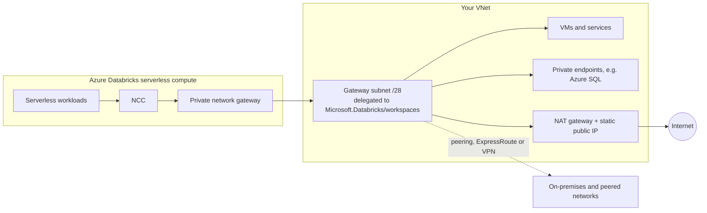

# Azure Databricks private network gateway for serverless compute

This example uses the [adb-private-network-gateway](../../modules/adb-private-network-gateway/) module.

It deploys an Azure Databricks [private network gateway](https://learn.microsoft.com/azure/databricks/security/network/serverless-network-security/private-network-gateway) (Public Preview) so serverless compute can reach resources in your VNet, networks connected to it, or the internet through your own egress path. It creates:

* A resource group and a VNet with a dedicated /28 gateway subnet, delegated to `Microsoft.Databricks/workspaces`.
* A NAT gateway with a static public IP, optionally attached to the gateway subnet.
* A network connectivity configuration (NCC).
* The private network gateway in that NCC.
* Optionally, private DNS zone links to the VNet.
* Optionally, a binding of the NCC to an existing workspace (`databricks_mws_ncc_binding`).

## Architecture



`SPECIFIC_DESTINATIONS` sends only the listed DNS names through the gateway. `ALL_TRAFFIC` sends all remaining serverless egress through it, so internet-bound traffic leaves from the NAT gateway public IP. NCC private endpoint rules and Azure service endpoints still take precedence ([routing order](https://learn.microsoft.com/azure/databricks/security/network/serverless-network-security/private-network-gateway#how-it-works)).

## Prerequisites

From [Configure a private network gateway](https://learn.microsoft.com/azure/databricks/security/network/serverless-network-security/private-network-gateway/configure-private-network-gateway):

* An Azure Databricks account on the Premium plan, with serverless compute enabled in the workspaces that will use the gateway.
* Azure Databricks account admin privileges.
* The private network gateway preview enabled on the account console Previews page.
* Permission to create a resource group, VNet, NAT gateway and a delegated subnet in the Azure subscription. The subscription must be in the same Microsoft Entra ID tenant as the workspaces.
* A supported region: australiaeast, brazilsouth, canadacentral, centralindia, centralus, eastasia, eastus, eastus2, francecentral, germanywestcentral, japaneast, koreacentral, northcentralus, northeurope, southcentralus, southeastasia, swedencentral, switzerlandnorth, uaenorth, uksouth, westcentralus, westeurope, westus, westus2 or westus3. The NCC, gateway subnet and workspaces must be in the same region.

## How to use

1. Sign in with `az login`. The Databricks provider uses `azure-cli` auth by default. For OAuth machine-to-machine auth, set `databricks_auth_type = "oauth-m2m"` and export `DATABRICKS_CLIENT_ID` and `DATABRICKS_CLIENT_SECRET` for an account admin service principal.
2. Copy `terraform.tfvars.example` to `terraform.tfvars` and set your values.
3. Run `terraform init`.
4. Run `terraform plan` to preview the deployment.
5. Run `terraform apply`. Creating the gateway can take several minutes.
6. Check that `terraform output gateway_state` is `ESTABLISHED`. Run `terraform refresh` if it still shows `CREATING`.
7. To use the gateway from a workspace, set `workspace_id` and apply again, or attach the NCC to the workspace in the account console. Binding an NCC replaces any NCC already attached to the workspace.

You can change `destinations`, `traffic_mode`, `private_dns_resolvers` and `bandwidth_tier_gbps` in place.

## Clean up

Run `terraform destroy`. The gateway delete returns immediately, but cleanup continues in the background, and until it finishes the subnet and the NCC cannot be deleted. The module waits 30 minutes (`gateway_destroy_wait`) after deleting the gateway before it deletes the subnet, and Terraform deletes the NCC after that. If destroy fails with `InUseSubnetCannotBeDeleted` or `has one or more attached private network gateway(s)`, wait and run `terraform destroy` again.

## Pattern A: SPECIFIC_DESTINATIONS for private services

Use this for VMs and services in the VNet, on-premises systems, and Azure PaaS resources behind a private endpoint, such as Azure SQL Database.

```hcl
traffic_mode = "SPECIFIC_DESTINATIONS"
destinations = [
  "db.example.internal",           # VM or service in a private DNS zone linked to the VNet
  "myserver.database.windows.net", # Azure SQL Database with a private endpoint in the VNet
]
private_dns_zone_ids = [
  "/subscriptions/<subscription_id>/resourceGroups/<rg>/providers/Microsoft.Network/privateDnsZones/example.internal",
  "/subscriptions/<subscription_id>/resourceGroups/<rg>/providers/Microsoft.Network/privateDnsZones/privatelink.database.windows.net",
]
```

* The gateway resolves names with Azure-provided DNS of the VNet, unless you set `private_dns_resolvers`. Link private DNS zones to the VNet that contains the gateway subnet. If you have private DNS zones with overlapping names, use your own resolver.
* Check that NSGs on the gateway subnet and the target allow the traffic, and that database firewalls allow the gateway subnet range.
* Observed during Public Preview (Nov 2026): private IPs and private DNS names in the VNet, and Azure SQL Database through a private endpoint, were reachable from serverless compute in this mode.

## Pattern B: ALL_TRAFFIC with a NAT gateway for a static egress IP

Use this when downstream systems allowlist a fixed source IP, or when all serverless egress must pass through your own egress path.

```hcl
traffic_mode       = "ALL_TRAFFIC"
destinations       = []
attach_nat_gateway = true
```

* Serverless internet egress leaves from `terraform output nat_public_ip`. To inspect traffic, route the gateway subnet to a firewall instead.
* In this mode you must add every intended destination to the serverless egress network policy. See [What is serverless egress control?](https://learn.microsoft.com/azure/databricks/security/network/serverless-network-security/network-policies).
* Observed during Public Preview (Nov 2026): with a NAT gateway on the gateway subnet, serverless compute used the NAT public IP as its egress IP.

## Known limitations (preview)

* Use NCC private endpoint rules, not the gateway, for Azure Storage, Key Vault and Service Bus or Event Hubs. The API rejects these names as destinations with `The following destinations are reserved and cannot be used as PNG destinations`. The module checks for them at plan time.
* `private_dns_resolvers` cannot contain `168.63.129.16`. Leave it empty to use Azure-provided DNS.
* Observed during Public Preview (Nov 2026): in `ALL_TRAFFIC` mode, names that exist only in private DNS zones did not resolve from serverless compute. Use `SPECIFIC_DESTINATIONS` for those names.
* Observed during Public Preview (Nov 2026): `ALL_TRAFFIC` without an egress path on the gateway subnet (no NAT gateway or firewall route) breaks serverless internet egress. Keep `attach_nat_gateway = true` in this mode.
* An NCC supports at most two gateways. A gateway supports at most two DNS resolvers and 100 destinations.
* To change the gateway subnet, delete the gateway and create a new one.
* Deleting the gateway cuts off connectivity for workloads that depend on it. Delete returns immediately and infrastructure cleanup continues in the background. See [Clean up](#clean-up).

<!-- BEGIN_TF_DOCS -->
## Requirements

| Name | Version |
| ---- | ------- |
| <a name="requirement_terraform"></a> [terraform](#requirement\_terraform) | >= 1.5 |
| <a name="requirement_azurerm"></a> [azurerm](#requirement\_azurerm) | >= 4.0, < 5.0 |
| <a name="requirement_databricks"></a> [databricks](#requirement\_databricks) | >= 1.140.0 |

## Providers

| Name | Version |
| ---- | ------- |
| <a name="provider_azurerm"></a> [azurerm](#provider\_azurerm) | >= 4.0, < 5.0 |
| <a name="provider_databricks"></a> [databricks](#provider\_databricks) | >= 1.140.0 |

## Modules

| Name | Source | Version |
| ---- | ------ | ------- |
| <a name="module_private_network_gateway"></a> [private\_network\_gateway](#module\_private\_network\_gateway) | ../../modules/adb-private-network-gateway | n/a |

## Resources

| Name | Type |
| ---- | ---- |
| [azurerm_nat_gateway.this](https://registry.terraform.io/providers/hashicorp/azurerm/latest/docs/resources/nat_gateway) | resource |
| [azurerm_nat_gateway_public_ip_association.this](https://registry.terraform.io/providers/hashicorp/azurerm/latest/docs/resources/nat_gateway_public_ip_association) | resource |
| [azurerm_private_dns_zone_virtual_network_link.this](https://registry.terraform.io/providers/hashicorp/azurerm/latest/docs/resources/private_dns_zone_virtual_network_link) | resource |
| [azurerm_public_ip.nat](https://registry.terraform.io/providers/hashicorp/azurerm/latest/docs/resources/public_ip) | resource |
| [azurerm_resource_group.this](https://registry.terraform.io/providers/hashicorp/azurerm/latest/docs/resources/resource_group) | resource |
| [azurerm_virtual_network.this](https://registry.terraform.io/providers/hashicorp/azurerm/latest/docs/resources/virtual_network) | resource |
| [databricks_mws_ncc_binding.this](https://registry.terraform.io/providers/databricks/databricks/latest/docs/resources/mws_ncc_binding) | resource |
| [databricks_mws_network_connectivity_config.this](https://registry.terraform.io/providers/databricks/databricks/latest/docs/resources/mws_network_connectivity_config) | resource |

## Inputs

| Name | Description | Type | Default | Required |
| ---- | ----------- | ---- | ------- | :------: |
| <a name="input_azure_subscription_id"></a> [azure\_subscription\_id](#input\_azure\_subscription\_id) | Azure subscription ID for the resource group, VNet and NAT gateway. | `string` | n/a | yes |
| <a name="input_databricks_account_id"></a> [databricks\_account\_id](#input\_databricks\_account\_id) | Databricks account ID (shown in the account console). | `string` | n/a | yes |
| <a name="input_attach_nat_gateway"></a> [attach\_nat\_gateway](#input\_attach\_nat\_gateway) | Associate the example NAT gateway with the gateway subnet. Gives internet-bound gateway traffic a static egress IP. | `bool` | `true` | no |
| <a name="input_azure_tenant_id"></a> [azure\_tenant\_id](#input\_azure\_tenant\_id) | Microsoft Entra ID tenant ID used by the Databricks provider with azure-cli auth. null uses the Azure CLI default tenant. | `string` | `null` | no |
| <a name="input_bandwidth_tier_gbps"></a> [bandwidth\_tier\_gbps](#input\_bandwidth\_tier\_gbps) | Gateway bandwidth tier in Gbps: 10, 30, 50 or 100. | `number` | `10` | no |
| <a name="input_databricks_auth_type"></a> [databricks\_auth\_type](#input\_databricks\_auth\_type) | Auth type for the account-level Databricks provider, for example azure-cli or oauth-m2m. | `string` | `"azure-cli"` | no |
| <a name="input_destinations"></a> [destinations](#input\_destinations) | DNS names routed through the gateway in SPECIFIC\_DESTINATIONS mode. Must be empty for ALL\_TRAFFIC. | `list(string)` | `[]` | no |
| <a name="input_gateway_subnet_address_prefix"></a> [gateway\_subnet\_address\_prefix](#input\_gateway\_subnet\_address\_prefix) | CIDR of the gateway subnet (/28 or larger, inside vnet\_address\_space). | `string` | `"10.0.0.0/28"` | no |
| <a name="input_location"></a> [location](#input\_location) | Azure region. Must support private network gateway during Public Preview. | `string` | `"eastus2"` | no |
| <a name="input_prefix"></a> [prefix](#input\_prefix) | Prefix for resource names. | `string` | `"png-example"` | no |
| <a name="input_private_dns_resolvers"></a> [private\_dns\_resolvers](#input\_private\_dns\_resolvers) | Custom DNS resolver IPs reachable from the gateway subnet (at most 2). Empty uses Azure-provided DNS. | `list(string)` | `[]` | no |
| <a name="input_private_dns_zone_ids"></a> [private\_dns\_zone\_ids](#input\_private\_dns\_zone\_ids) | Resource IDs of existing private DNS zones to link to the VNet, so the gateway can resolve names in them. | `list(string)` | `[]` | no |
| <a name="input_tags"></a> [tags](#input\_tags) | Tags applied to Azure resources. | `map(string)` | `{}` | no |
| <a name="input_traffic_mode"></a> [traffic\_mode](#input\_traffic\_mode) | SPECIFIC\_DESTINATIONS or ALL\_TRAFFIC. | `string` | `"SPECIFIC_DESTINATIONS"` | no |
| <a name="input_vnet_address_space"></a> [vnet\_address\_space](#input\_vnet\_address\_space) | Address space of the VNet created by this example. | `string` | `"10.0.0.0/24"` | no |
| <a name="input_workspace_id"></a> [workspace\_id](#input\_workspace\_id) | Optional workspace ID to bind to the NCC. null creates no binding. The workspace must be in the same region. Binding replaces any NCC already attached to the workspace. | `string` | `null` | no |

## Outputs

| Name | Description |
| ---- | ----------- |
| <a name="output_gateway_id"></a> [gateway\_id](#output\_gateway\_id) | ID of the private network gateway. |
| <a name="output_gateway_name"></a> [gateway\_name](#output\_gateway\_name) | Full resource name of the private network gateway. |
| <a name="output_gateway_state"></a> [gateway\_state](#output\_gateway\_state) | Gateway state: CREATING, ESTABLISHED or FAILED. |
| <a name="output_gateway_subnet_id"></a> [gateway\_subnet\_id](#output\_gateway\_subnet\_id) | Resource ID of the delegated gateway subnet. |
| <a name="output_nat_public_ip"></a> [nat\_public\_ip](#output\_nat\_public\_ip) | Static egress IP of the NAT gateway. Serverless internet egress uses it in ALL\_TRAFFIC mode when attach\_nat\_gateway is true. |
| <a name="output_network_connectivity_config_id"></a> [network\_connectivity\_config\_id](#output\_network\_connectivity\_config\_id) | ID of the NCC that owns the gateway. |
<!-- END_TF_DOCS -->
